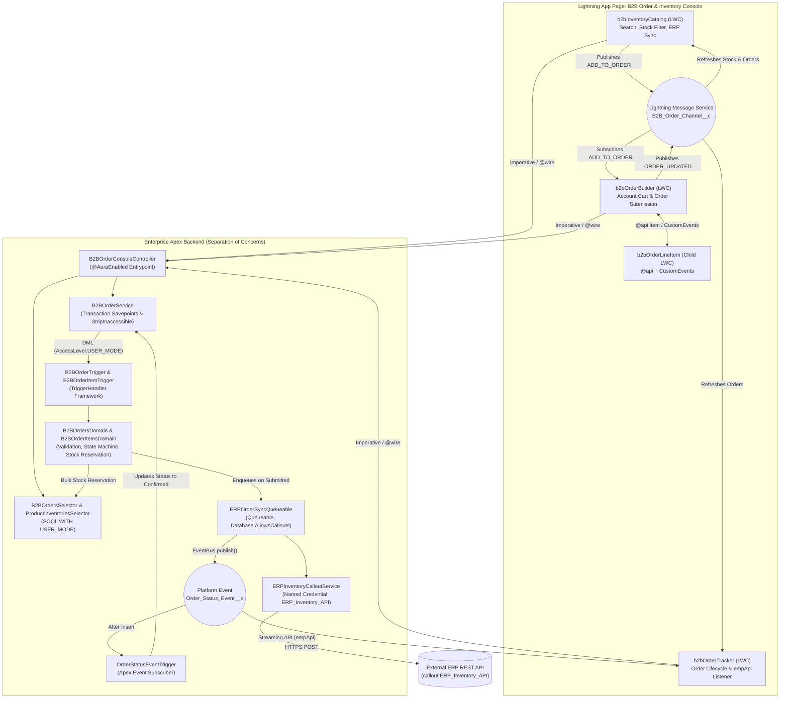
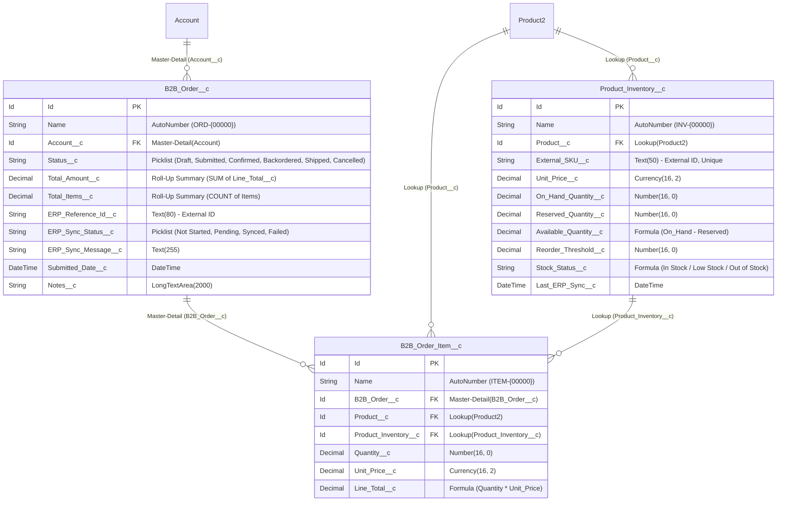

# Salesforce B2B Order & Inventory Console

A production-grade Salesforce DX (SFDX) portfolio application demonstrating **Apex Enterprise Patterns (Separation of Concerns)**, **strict CRUD/FLS security (`WITH USER_MODE` & `Security.stripInaccessible`)**, **Named Credential REST Callout Integration**, **Event-Driven Asynchronous Processing (`Queueable` + `Platform Events`)**, and **modern Lightning Web Components (SLDS, LMS, Custom Events, and `lightning/empApi`)**.

---

## Table of Contents
1. [Executive Overview](#1-executive-overview)
2. [System Architecture & Event Flow](#2-system-architecture--event-flow)
3. [Data Model (ERD)](#3-data-model-erd)
4. [Enterprise Apex Architecture (Separation of Concerns)](#4-enterprise-apex-architecture-separation-of-concerns)
5. [LWC Frontend & SLDS Design System](#5-lwc-frontend--slds-design-system)
6. [Deployment & Quickstart Guide](#6-deployment--quickstart-guide)
7. [End-to-End QA & Live Demo Test Guide](#7-end-to-end-qa--live-demo-test-guide)

---

## 1. Executive Overview

The **B2B Order & Inventory Console** is a unified workspace designed for B2B account managers and fulfillment operations teams to:
* Browse real-time warehouse stock (`On Hand`, `Reserved`, and `Available` quantities) across catalog products (`Product2` + `Product_Inventory__c`).
* Synchronize live inventory levels on-demand with an external ERP endpoint via a Salesforce **Named Credential** (`callout:ERP_Inventory_API`).
* Build, validate, and submit multi-line B2B customer orders (`B2B_Order__c` + `B2B_Order_Item__c`) with instant stock reservation and rollback safety.
* Process ERP order confirmations asynchronously via **`Queueable` Apex (`Database.AllowsCallouts`)** and broadcast live updates back to the UI using **Platform Events (`Order_Status_Event__e`)** and **`lightning/empApi`**.

---

## 2. System Architecture & Event Flow



---

## 3. Data Model (ERD)



---

## 4. Enterprise Apex Architecture (Separation of Concerns)

| Architectural Layer | Classes | Responsibility |
| :--- | :--- | :--- |
| **Trigger Framework** | `TriggerHandler`, `B2BOrderTriggerHandler`, `B2BOrderItemTriggerHandler`, `ProductInventoryTriggerHandler`, `OrderStatusEventTriggerHandler` | Context dispatch (`beforeInsert`, `afterUpdate`, etc.), static bypass API (`TriggerHandler.bypass()`), recursion guards, and zero business logic in triggers. |
| **Selector Layer** | `ProductInventoriesSelector`, `B2BOrdersSelector` | Encapsulates all SOQL queries with strict **`WITH USER_MODE`** enforcement, bulkified `Set<Id>` parameters, and dynamic catalog search/filtering. |
| **Domain Layer** | `B2BOrdersDomain`, `B2BOrderItemsDomain`, `ProductInventoriesDomain` | Enforces SObject state machines (`Draft` → `Submitted` → `Confirmed` → `Shipped` / `Cancelled`), Draft-only item lock rules, SKU normalization, and bulkified inventory reservation/deduction/release across 200+ records. |
| **Service Layer** | `B2BOrderService`, `ERPInventoryCalloutService`, `ERPOrderSyncQueueable` | Orchestrates atomic multi-object transactions (`Database.setSavepoint()` / `Database.rollback()`), `Security.stripInaccessible`, Named Credential REST callouts, governor-safe Queueable chunking (`MAX_CALLOUTS_PER_TRANSACTION = 90`), and Platform Event publishing. |
| **Controller Layer** | `B2BOrderConsoleController` | Thin `@AuraEnabled` boundary delegating to Service and Selector layers with clean `AuraHandledException` mapping. |
| **Test Suite (`91%` Coverage)** | `B2BOrderConsoleTest`, `B2BTestDataFactory`, `ERPInventoryHttpCalloutMock` | Verifies positive flows, negative validation guardrails, HTTP `200`/`409`/`500` callout mocks, and 210-order bulkification without hitting governor limits. |

---

## 5. LWC Frontend & SLDS Design System

The frontend is built strictly on the **Salesforce Lightning Design System (SLDS)**:
* **100% Native SLDS Utility & Component Styling:** Uses `slds-box`, `slds-theme_shade`, `slds-badge` (`slds-theme_success`, `slds-theme_warning`, `slds-theme_error`, `slds-badge_lightest`), `slds-table_striped`, `slds-table_col-bordered`, `lightning-button-group`, `slds-scrollable_y`, and SLDS Styling Hooks (`var(--lwc-colorBackgroundRowHover)`).
* **Cross-DOM Sibling Decoupling via LMS (`B2B_Order_Channel__c`):** `b2bInventoryCatalog`, `b2bOrderBuilder`, and `b2bOrderTracker` communicate across independent FlexiPage regions without tight coupling.
* **Parent-Child Composition (`@api` + `CustomEvent`):** `b2bOrderBuilder` passes line state down to `b2bOrderLineItem` via `@api item` and listens for `quantitychange` and `removeitem` custom events.
* **Real-Time Streaming (`lightning/empApi`):** `b2bOrderTracker` subscribes to `/event/Order_Status_Event__e` to display instant ERP confirmation toasts and refresh stock/order tables automatically.

---

## 6. Deployment & Quickstart Guide

### Prerequisites
* Salesforce CLI (`sf`) v2.x+
* An authenticated Salesforce Developer Edition or Scratch Org

### 1. Clone the Repository
```bash
git clone https://github.com/joaopedroslc/salesforce-b2b-order-console.git
cd salesforce-b2b-order-console
npm install
```

### 2. Authorize Your Salesforce Org
```bash
sf org login web --set-default --alias joaoslc_portfolio
```

### 3. Deploy Metadata & Assign Permission Set
```bash
sf project deploy start --source-dir force-app/main/default
sf org assign permset --name B2B_Order_Console_Admin
```

### 4. Run the Apex Test Suite with Code Coverage
```bash
sf apex run test --class-names B2BOrderConsoleTest --code-coverage --result-format human --synchronous
```

### 5. Launch the Application (Internal Lightning Experience)
1. Run `sf org open` to open your Salesforce org.
2. Click the **App Launcher** (9 dots in the top-left corner) and search for **B2B Order Console**.
3. Click **Seed Demo Data** in the top-right of the **B2B Warehouse Inventory Catalog** card to populate sample B2B Accounts, Products, and Inventory records.

### 6. Publish as a Public Live Portfolio Site (Experience Cloud)
All components (`b2bOrderConsoleWorkspace`, `b2bInventoryCatalog`, `b2bOrderBuilder`, and `b2bOrderTracker`) are configured with `lightningCommunity__Page` and `lightningCommunity__Default` targets, plus controlled Guest User demo support in `B2BOrderConsoleController`:
1. In **Setup**, search for **Digital Experiences** → **Settings**, check **Enable Digital Experiences**, and click **Save**.
2. Go to **Setup** → **Digital Experiences** → **All Sites** → **New**, choose the **Build Your Own (Aura)** or **Customer Account Portal** template, name it `B2B Order Console Portfolio`, and click **Create**.
3. In **Administration** → **Preferences**, check **Give access to public API requests on Chatter** and click **Save**.
4. Open **Builder**, click the **Settings (Gear icon)** → **General**, check **Public Access ("Guest users can see and interact with the site without logging in")**, and click the **Guest User Profile** link → **Enabled Apex Class Access** → **Edit** → add `B2BOrderConsoleController` → **Save**.
5. In **Builder** → **Components** (lightning bolt icon), drag **B2B Order Console Workspace (All-in-One)** (`c-b2b-order-console-workspace`) onto the Home page content region and click **Publish**.

---

## 7. End-to-End QA & Live Demo Test Guide

See the complete step-by-step interactive walkthrough in **[docs/END_TO_END_QA_GUIDE.md](docs/END_TO_END_QA_GUIDE.md)** for testing every positive, negative, live ERP callout, Platform Event streaming, and bulk scenario.
