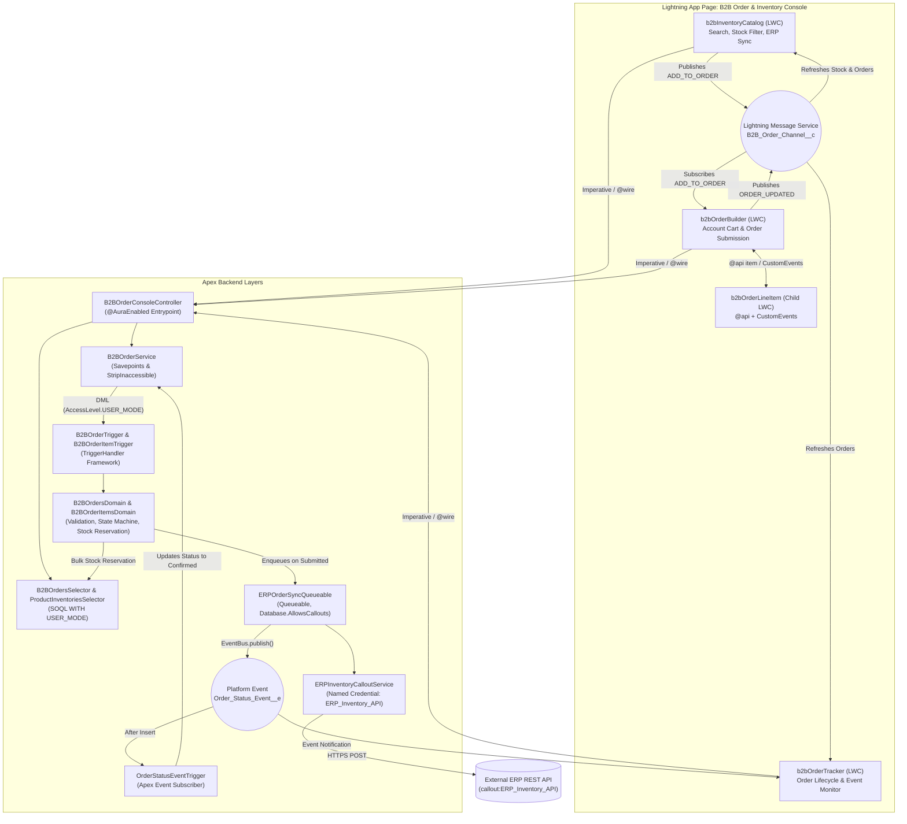
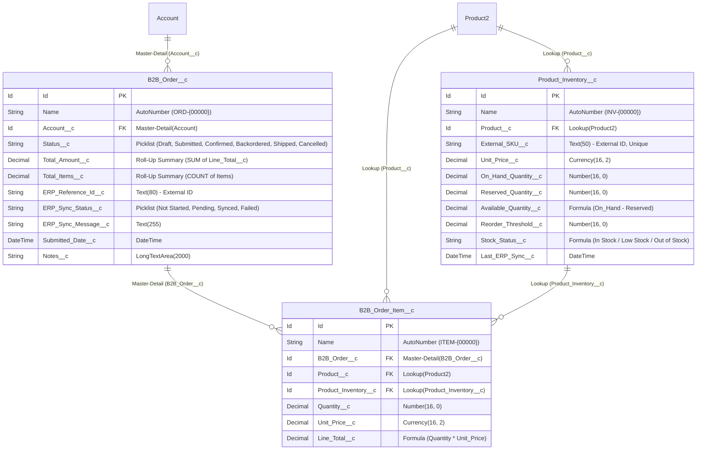

# Salesforce B2B Order & Inventory Console

Salesforce DX application implementing Apex Enterprise Patterns (Trigger Handler, Selector, Domain, Service, and Controller layers), CRUD/FLS enforcement via `AccessLevel.USER_MODE` and `Security.stripInaccessible()`, Named Credential REST callouts (`callout:ERP_Inventory_API`), asynchronous Queueable processing (`Database.AllowsCallouts`), Platform Events (`Order_Status_Event__e`), and Lightning Web Components built on SLDS and Lightning Message Service (`B2B_Order_Channel__c`).

---

## Table of Contents
1. [Overview](#1-overview)
2. [System Architecture & Event Flow](#2-system-architecture--event-flow)
3. [Data Model (ERD)](#3-data-model-erd)
4. [Apex Backend Architecture](#4-apex-backend-architecture)
5. [LWC Frontend & SLDS Architecture](#5-lwc-frontend--slds-architecture)
6. [Deployment & Quickstart](#6-deployment--quickstart)
7. [End-to-End QA Walkthrough](#7-end-to-end-qa-walkthrough)

---

## 1. Overview

The B2B Order & Inventory Console provides a two-column workspace for B2B account managers and fulfillment teams to check real-time warehouse stock, synchronize inventory with an external ERP endpoint, and submit multi-line customer orders.

Users browse catalog inventory (`Product2` and `Product_Inventory__c`) with real-time `On_Hand_Quantity__c`, `Reserved_Quantity__c`, and formula-calculated `Available_Quantity__c` metrics. On-demand synchronization sends an outbound HTTPS POST request through the `ERP_Inventory_API` Named Credential to replenish low-stock SKUs.

When an order (`B2B_Order__c` and `B2B_Order_Item__c`) is submitted, `B2BOrderService` wraps header creation, line item insertion, and status transition inside a `Database.setSavepoint()` transaction. `B2BOrdersDomain` locks the requested stock on `Product_Inventory__c` and enqueues `ERPOrderSyncQueueable`. The Queueable worker executes the outbound ERP REST callout and publishes an `Order_Status_Event__e` Platform Event, which updates the order to `Confirmed` or `Backordered` and notifies the UI.

---

## 2. System Architecture & Event Flow



---

## 3. Data Model (ERD)



---

## 4. Apex Backend Architecture

| Layer | Classes | Responsibility |
| :--- | :--- | :--- |
| Trigger Framework | `TriggerHandler`, `B2BOrderTriggerHandler`, `B2BOrderItemTriggerHandler`, `ProductInventoryTriggerHandler`, `OrderStatusEventTriggerHandler` | Dispatches trigger contexts (`beforeInsert`, `afterUpdate`, etc.), enforces recursion guards, and exposes static bypass controls (`TriggerHandler.bypass()`). |
| Selector Layer | `ProductInventoriesSelector`, `B2BOrdersSelector` | Executes parameterized SOQL queries via `Database.queryWithBinds` with `AccessLevel.USER_MODE` enforcement and `Set<Id>` bulk inputs. |
| Domain Layer | `B2BOrdersDomain`, `B2BOrderItemsDomain`, `ProductInventoriesDomain` | Enforces order state transitions (`Draft` to `Submitted` to `Confirmed` to `Shipped` or `Cancelled`), blocks edits on non-Draft line items, normalizes SKUs to uppercase, and calculates bulk inventory reservations, deductions, and releases. |
| Service Layer | `B2BOrderService`, `ERPInventoryCalloutService`, `ERPOrderSyncQueueable` | Coordinates multi-object DML inside `Database.setSavepoint()` transactions, strips inaccessible fields with `Security.stripInaccessible()`, performs Named Credential REST callouts, chunks Queueable callouts at `MAX_CALLOUTS_PER_TRANSACTION = 90`, and publishes `Order_Status_Event__e` events. |
| Controller Layer | `B2BOrderConsoleController` | Exposes `@AuraEnabled` methods for LWC callers and maps backend exceptions to `AuraHandledException`. |
| Test Suite (92% Coverage) | `B2BOrderConsoleTest`, `B2BTestDataFactory`, `ERPInventoryHttpCalloutMock` | Tests positive order flows, negative domain validations, HTTP `200`/`409`/`500` callout mocks, Guest User execution, and 210-order bulk submissions using `System.Assert`. |

---

## 5. LWC Frontend & SLDS Architecture

The UI consists of five Lightning Web Components styled with SLDS utility classes (`slds-box`, `slds-theme_shade`, `slds-badge`, `slds-table_striped`, `slds-table_col-bordered`) and SLDS design tokens.

`b2bOrderConsoleWorkspace` serves as the top-level container for Lightning App Pages and Experience Cloud sites. On desktop viewports (`>= 1024px`), it renders the catalog in the left column and the order builder and fulfillment tracker in the right column. On mobile and tablet viewports (`< 1024px`), it provides a tab switcher bar (`Catalog`, `Cart`, `Orders`, `All`) with active flex expansion and a pulse animation on the `Cart` tab when items are added.

`b2bInventoryCatalog` displays warehouse inventory with interactive KPI filter cards, a 300ms debounced search input, stock status and sort selectors, removable filter pills, and action buttons for seeding demo records and syncing with the ERP endpoint.

`b2bOrderBuilder` and its child component `b2bOrderLineItem` manage the active customer cart. `b2bOrderBuilder` displays an account terms strip (`Tier 1 Wholesale`, `Net 30`, `Free Ground Freight`) and a financial summary box, passing each cart line down via `@api item` and listening for `quantitychange` and `removeitem` custom events. `b2bOrderLineItem` clamps manual quantity inputs between `1` and `availableQuantity` on blur.

`b2bOrderTracker` monitors submitted orders, providing search and lifecycle filtering, an SLDS progress indicator (`Draft` to `Submitted` to `Confirmed` to `Shipped`), an ERP telemetry inspection modal, and automatic polling when orders are awaiting asynchronous `Order_Status_Event__e` confirmation. Cross-component communication runs over the `B2B_Order_Channel__c` Lightning Message Channel.

---

## 6. Deployment & Quickstart

### Prerequisites
Install Salesforce CLI (`sf` v2.x+) and authenticate a Salesforce Developer Edition or Scratch Org.

### 1. Clone the Repository
```bash
git clone https://github.com/joaopedroslc/salesforce-b2b-order-console.git
cd salesforce-b2b-order-console
npm install
```

### 2. Authorize Your Salesforce Org
```bash
sf org login web --set-default --alias joaoslc_portfolio
```

### 3. Deploy Metadata & Assign Permission Set
```bash
sf project deploy start --source-dir force-app/main/default
sf org assign permset --name B2B_Order_Console_Admin
```

### 4. Run the Apex Test Suite
```bash
sf apex run test --class-names B2BOrderConsoleTest --code-coverage --result-format human --synchronous
```

### 5. Open the Application in Lightning Experience
Run `sf org open`, open the App Launcher, and select **B2B Order Console**. Click **Seed Data** in the **B2B Inventory Catalog** header to create sample B2B Accounts, Products, and Inventory records.

### 6. Experience Cloud Site Configuration
All components include `lightningCommunity__Page` and `lightningCommunity__Default` targets, and `B2BOrderConsoleController` includes a `GuestPortfolioRunner` inner class for unauthenticated demo visitors.

1. In Setup, open **Digital Experiences** > **Settings**, enable Digital Experiences, and save.
2. Create a site under **All Sites** > **New** using the Build Your Own (Aura or LWR) template.
3. In **Administration** > **Preferences**, enable **Give access to public API requests on Chatter**.
4. In Experience Builder **Settings** > **General**, enable Public Access, open the Guest User Profile, and grant access to `B2BOrderConsoleController` under **Enabled Apex Class Access**.
5. Drag `b2bOrderConsoleWorkspace` onto the page region and publish the site.

---

## 7. End-to-End QA Walkthrough

See [docs/END_TO_END_QA_GUIDE.md](docs/END_TO_END_QA_GUIDE.md) for the step-by-step verification checklist covering catalog seeding, filtering, Named Credential ERP callouts, Platform Event confirmations, order lifecycle transitions, negative validation rules, and 210-record bulk tests.
